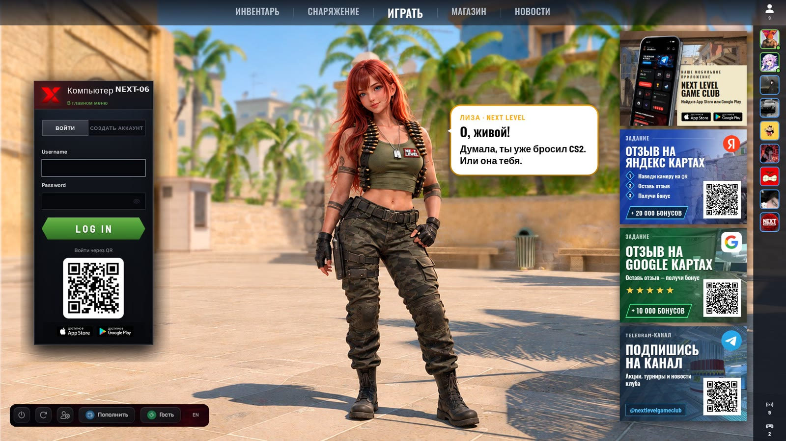
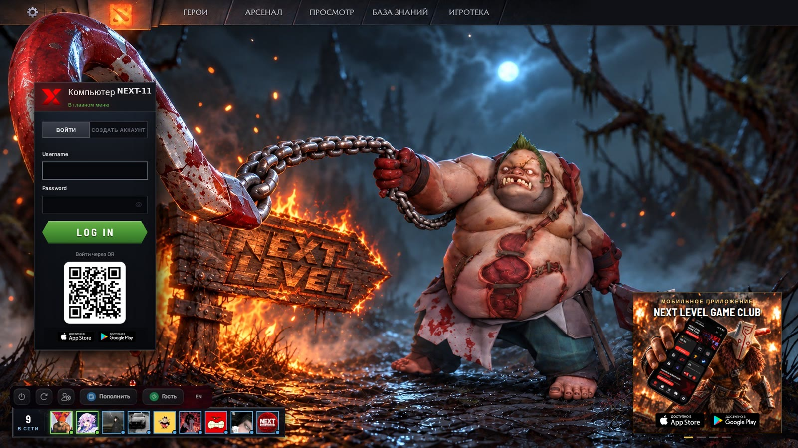
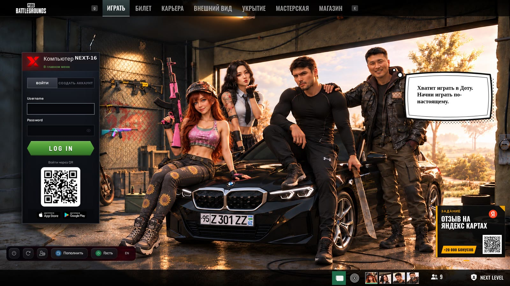
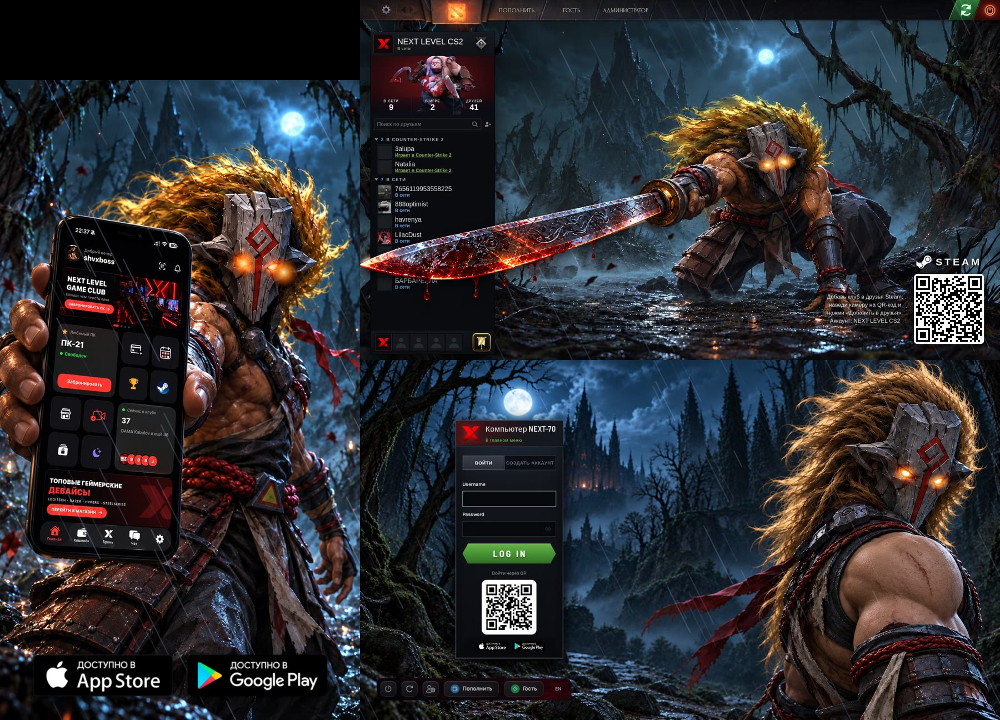

# iCafe custom themes

I work deeply with **iCafe** (iCafeCloud), the management software used by gaming clubs and internet cafes, and I can customize it however a club needs:
- fully custom **themes** for the login / lock screen and lobby (colors, fonts, backgrounds, animations, club branding)
- **different looks per PC group**: standard zone, VIP, game-specific halls (e.g. Dota 2 style)
- **multi-monitor layouts**, e.g. a stream room with three screens as one themed window
- custom pages, buttons, QR codes and links wired into the client
- settings, pricing and rollout with safe backups and instant rollback

Running my own gaming club on iCafe, so every change is tested on real PCs.

## Theme gallery (real club screens)

**CS2 hall**: login panel, lobby menu, promo panels with QR codes, friends list and an animated character

**Dota 2 hall**: Dota-client style top menu, login panel, friends bar and mobile-app promo

**PUBG hall**: PUBG-style navigation, login panel, bottom bar and task card over a custom background

**Stream room**: three monitors as one themed window: Juggernaut side screen, Dota-style friends panel and login on the main screen

## Need a theme for your club?
I design and install custom iCafe themes: branding, login screen, lobby, per-group looks and multi-monitor setups.

- Upwork: [Shaxboz R.](https://www.upwork.com/freelancers/~01e2d247c3648c350c)
- Studio: [upcloud.uz](https://upcloud.uz)
